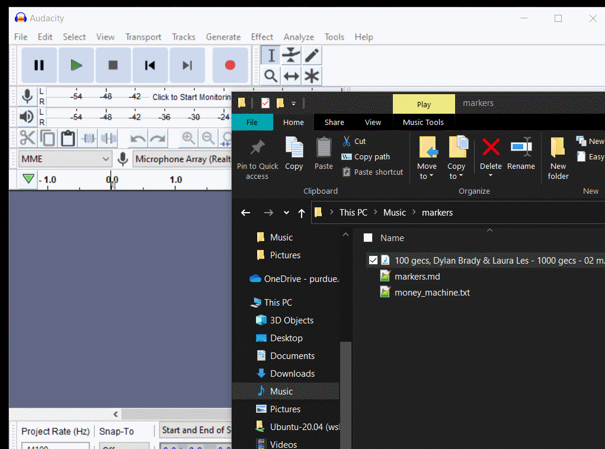
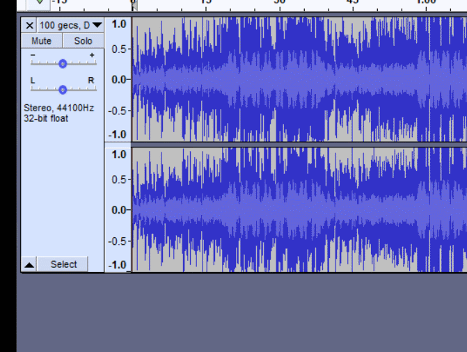
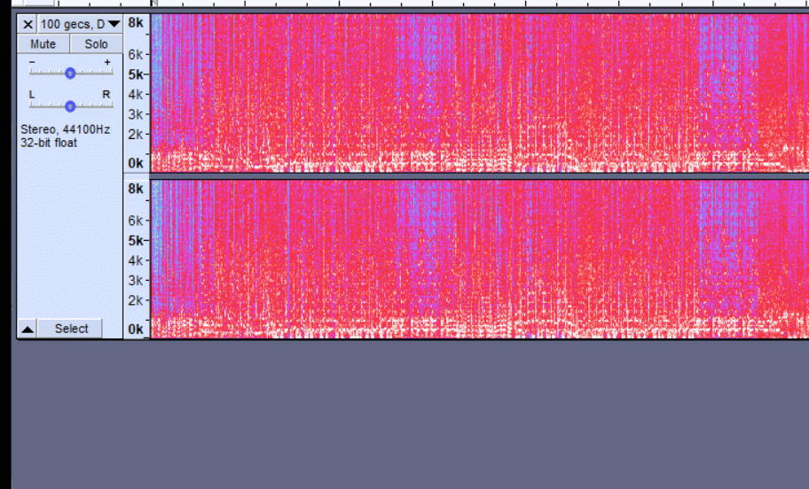
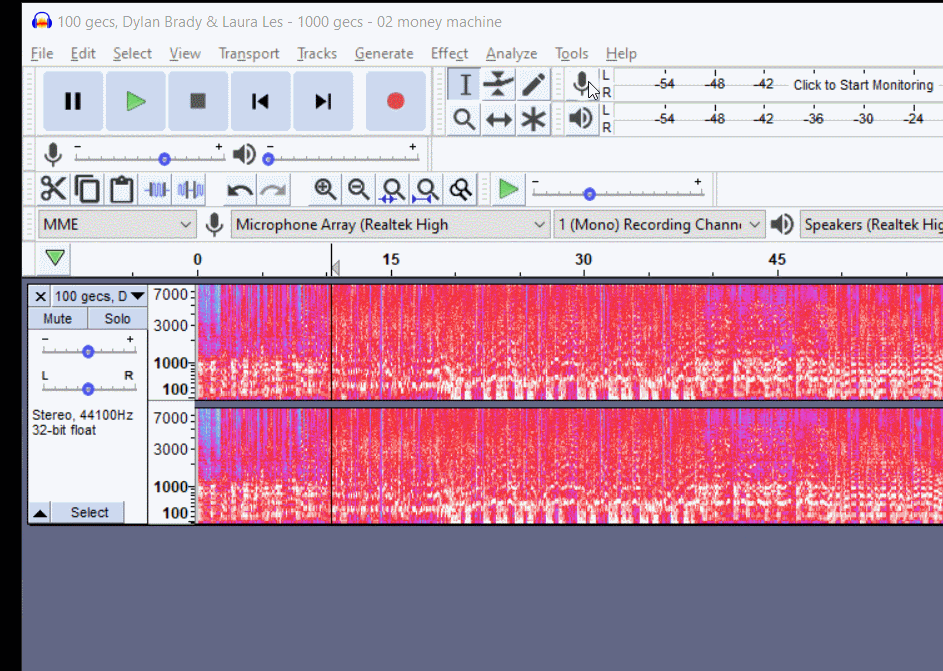
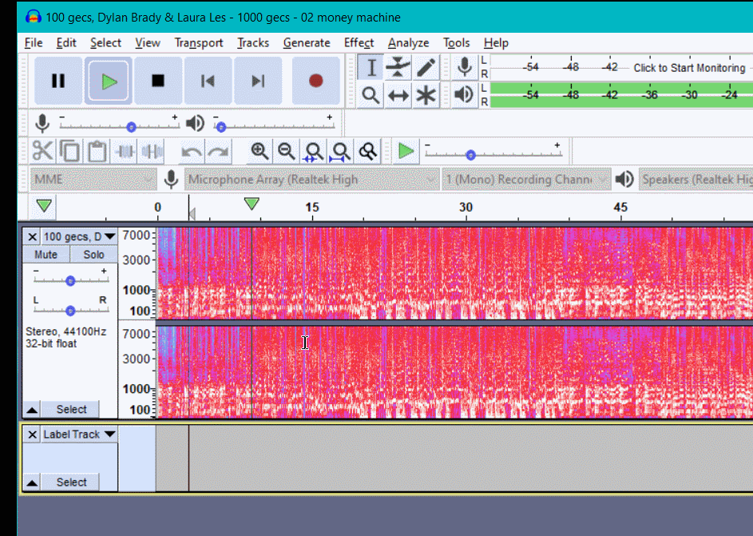
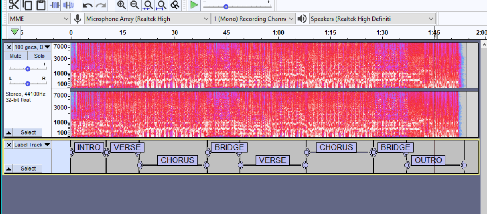
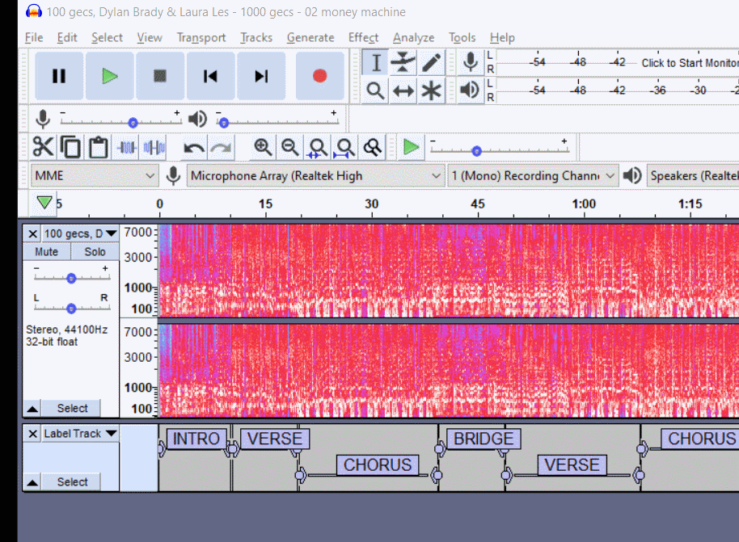

# Using Audacity to Make Labels

Thanks for helping out! I need labeled tracks to train this AI model. I'm not going to be able to write a better program than Audacity! 

Download [Audacity](https://www.audacityteam.org/) if you haven't already.

### Getting the song

Find a song. If you already have an mp3 of it, thats ideal. If not, just acquire one. I have youtube-mp3 handily set up already here, so just paste the link and the MP3 will show up.

### Set up in Audacity

Open the song in Audacity.

View the spectrogram

If desired, convert the scaling to Mel scaling (easier to read)

Create a new Label Track

### Audacity Controls

| Key   | Action    |
| ---   | ---       |
| `CTRL+SCROLL`   | Zoom in/out |
| `SHIFT+SCROLL`  | Slide View left/right |
| `Click`         | Select |
| `CTRL+B`:       | Add marker at selection |

### Labeling

Start Playing the track. As a section starts, click at the start of the section.

Press CTRL+B to create a new Label

Type the section of the song. For simplicity, only use one of these words:

| Keyword   | Description   |
| ---       | ---           |
| `INTRO`   | A unique section that comes at the beginning of the song. |
| `VERSE`   | The main stanzas of the song. Words vary but pattern repeats. |
| `PRECHORUS` | Connects the verse to the chorus with transitional material. |
| `CHORUS`  | The main part. Contains the hook. Repeats at least once. |
| `BRIDGE`  | A transitional section that contrasts with the verse and chorus. |
| `SOLO`    | If an instrument has a solo, include it here. |
| `OUTRO`   | The ending part. |

If you aren't sure, just don't label the section. Also, if you prefer, you can use single-letter labels, like `A` `B` and `C` to call out sections that are repeated.

Don't worry about getting millisecond-accuracy on the transitions, or having no gap between the markers. Don't spend too much time on a song and make sure to include the major parts. The most important distinction I will be making is "does the section repeat?"

### Output

Export the labels to a text file. Name the text file something similar to the song. 

